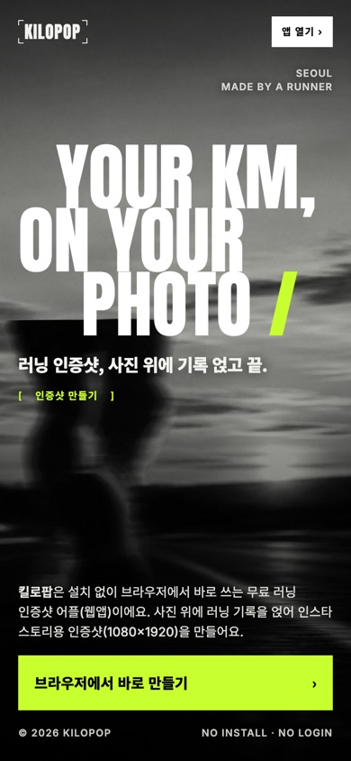
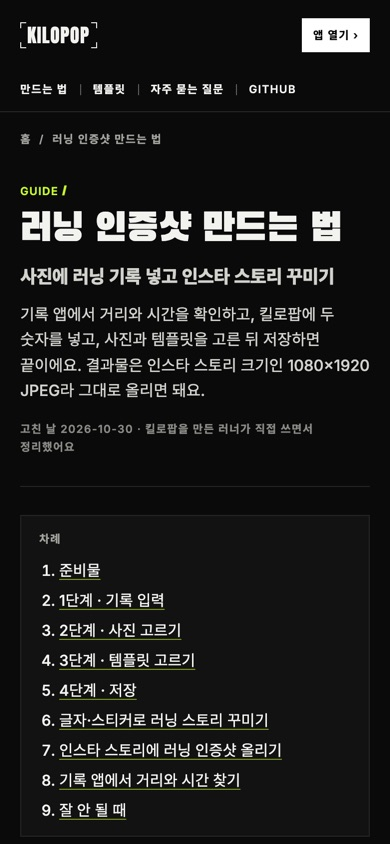
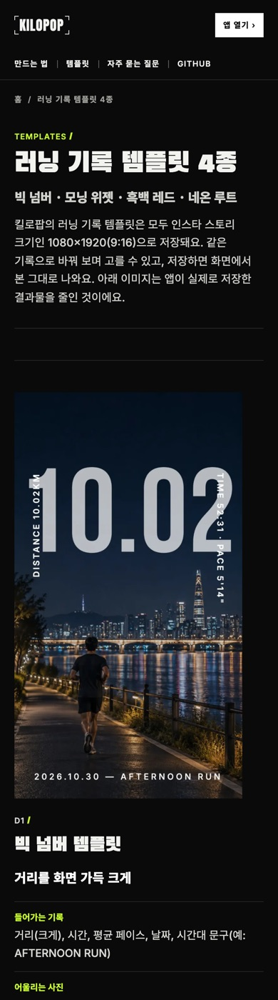
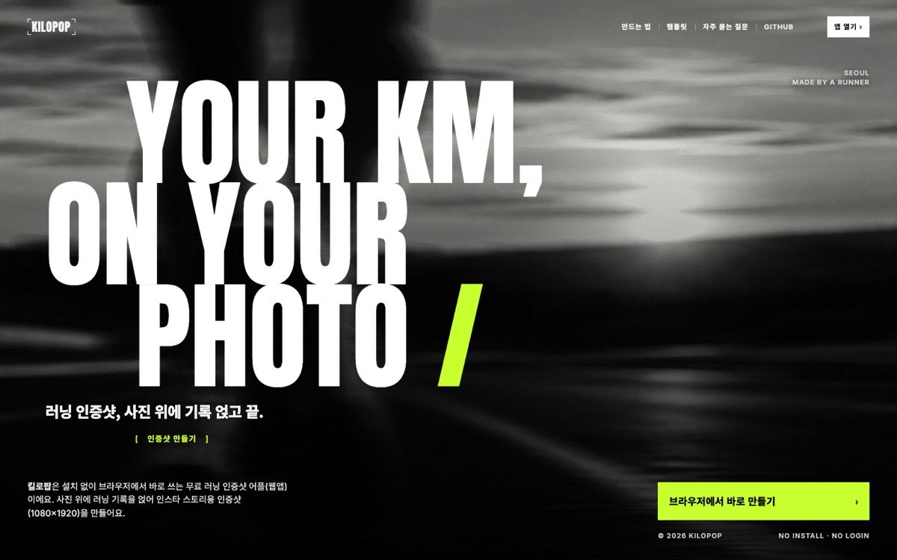

<div align="center">


# 킬로팝 KILOPOP · 소개 사이트

**러닝 인증샷, 사진 위에 기록 얹고 끝.**

킬로팝은 거리와 시간을 넣고 사진을 고르면 인스타 스토리용 러닝 인증샷(1080×1920)을 만들어 주는 무료 웹앱이에요.<br/>
이 레포는 그 앱을 소개하는 사이트예요. 설치도 로그인도 없이 바로 써 보세요.

[웹앱 열기](https://app.kilopop.thundo.kr/) · [러닝 인증샷 만드는 법](https://kilopop.thundo.kr/guide/running-photo/) · [템플릿 4종](https://kilopop.thundo.kr/templates/)

<br/>

&nbsp;
&nbsp;


</div>

<br/>



## 킬로팝은

| 단계 | 하는 일 |
|:---:|---|
| 1. 기록 | 거리와 시간만 넣으면 평균 페이스는 자동으로 계산돼요. `3406`만 쳐도 `34:06`이 돼요. |
| 2. 사진 | 앨범에서 고르거나, 바로 찍거나, 샘플 사진으로 둘러봐요. |
| 3. 템플릿 | 빅 넘버, 모닝 위젯, 흑백 레드, 네온 루트 중에 골라요. |
| 4. 저장 | 1080×1920 JPEG를 공유 시트로 사진 앱에 저장해요. 그대로 스토리에 올리면 돼요. |

사진과 기록은 폰 브라우저 안에서만 처리되고 서버로 가지 않아요. 앱 자체는 비공개 레포에서 만들고 있어요.

## 이 사이트가 하는 일

검색과 AI 답변에서 '러닝 인증샷'을 찾는 사람이 킬로팝을 만나게 하는 것이 목표예요. 실제 검색어(네이버·구글 자동완성)마다 답을 맡을 페이지를 하나씩 두었어요.

| 주소 | 맡는 질문 |
|---|---|
| `/` | 러닝 인증샷 어플이 뭐가 있어? 무료야? 사진이 서버에 올라가? |
| `/guide/running-photo/` | 사진에 러닝 기록 어떻게 넣어? 스토리에 어떻게 올려? |
| `/templates/` | 러닝 인증샷 템플릿 어떤 게 있어? |
| `/privacy/` | 개인정보는 어떻게 다뤄? |

- 모든 글과 링크가 HTML에 미리 들어 있어요. 자바스크립트를 실행하지 않는 검색·AI 수집기도 다 읽어요.
- 구조화 데이터(JSON-LD): WebSite, Organization, WebApplication, FAQPage, Article, HowTo, CollectionPage, BreadcrumbList. 질문과 답은 화면과 같은 원본(`src/content.mjs`)에서 나와 어긋나지 않아요. 평점처럼 근거 없는 값은 넣지 않았어요.
- `sitemap.xml`(이미지 정보 포함), `robots.txt`(네이버 Yeti, 구글, Bing, AI 검색 수집기 허용), `llms.txt`, IndexNow 키, Open Graph 이미지(카카오톡·네이버 미리보기).
- 자세한 설계와 근거는 [docs/seo-geo-aeo-plan.md](docs/seo-geo-aeo-plan.md)에 있어요.

## 성능과 접근성

`npm run perf`로 재요. 모바일(390×844), 느린 4G(지연 150ms, 1.6Mbps), CPU 4배 감속, 캐시 없음 기준이에요.

| 페이지 | LCP | CLS | 접근성(axe-core) |
|---|---:|---:|---|
| `/` | 1.4초 | 0.001 | 위반 없음 |
| `/guide/running-photo/` | 0.9초 | 0.010 | 위반 없음 |
| `/templates/` | 1.2초 | 0.000 | 위반 없음 |
| `/privacy/` | 0.9초 | 0.010 | 위반 없음 |

로컬 서버는 압축을 하지 않아 실제 배포(Vercel, brotli 압축)보다 전송량이 많게 잡혀요.

## 디자인

핀터레스트의 러닝 클럽 사이트 핀 'Drift Running Club'(https://kr.pinterest.com/pin/380343131407049784/)을 참고했어요. 움직임이 번진 흑백 러닝 사진, 계단식으로 들여 쓴 압축체 대문자 제목, 회색 대형 숫자 위를 지나는 경로 선, 하나만 컬러로 보이는 번호 카드가 그 핀에서 얻은 아이디어예요. 색은 앱과 같은 검정과 형광 라임(`#C8FF2E`)이고, 글꼴은 Anton(영문 제목), Black Han Sans(한글 제목), Inter, Noto Sans KR이에요. 시안을 고른 과정은 [docs/design-process.md](docs/design-process.md)에 있어요.

## 실행하기

Node 24 기준이고, 외부 패키지가 없어 설치할 것이 없어요.

```bash
npm test          # 빌드 + 검사(제목·설명·canonical·구조화 데이터·FAQ 일치·이미지 크기·내부 링크·사이트맵·운영 CSP 위반)
npm run serve     # dist/를 http://localhost:5311 로 띄우기
npm run perf      # 모바일 성능·접근성 측정 (serve를 먼저 띄운 상태에서, macOS Chrome 필요)
```

## 이름과 주소 바꾸기

이름(킬로팝/Kilopop), 사이트 주소, 앱 주소, 레포 주소는 `site.config.json` 한 곳에 있어요. 이름 뒤 조사(은/는, 이/가)는 받침에 맞춰 자동으로 골라요. 바꾼 뒤 `npm test`로 다시 빌드하고, 공유 이미지에 이름이 들어가므로 `npm run og`도 실행해요. Vercel에서는 운영 주소(`VERCEL_PROJECT_PRODUCTION_URL`)를 자동으로 읽어 canonical과 사이트맵에 써요.

주소 배치는 소개 사이트가 `kilopop.thundo.kr`, 웹앱이 `app.kilopop.thundo.kr`이에요. 예전에 `kilopop.thundo.kr`에서 앱을 연 기기에 남은 앱 서비스 워커는 `public/sw.js`가 지워 줘요(이 사이트는 그 파일을 등록하지 않아요).

## 배포

Vercel에서 이 레포를 가져오면 `vercel.json`대로 빌드하고 검사까지 통과해야 배포돼요. 배포 뒤에는 검색엔진에 알려요.

1. Google Search Console, 네이버 서치어드바이저, Bing Webmaster Tools에 사이트를 등록하고 `sitemap.xml`을 제출해요. 소유 확인 값은 `site.config.json`의 `googleVerification`, `naverVerification`에 넣으면 메타 태그로 들어가요.
2. `SITE_URL=https://운영주소 npm run indexnow`로 Bing·네이버에 바뀐 주소를 알려요.

## 폴더

```
site.config.json   이름·주소·IndexNow 키
src/content.mjs    질문과 답, 만드는 법 단계, 템플릿 설명 (화면과 구조화 데이터의 원본)
src/pages.mjs      페이지 다섯 개
src/layout.mjs     메타 태그, 메뉴, 바닥글
src/schema.mjs     구조화 데이터
src/site.css       디자인
src/site.js        템플릿 카드·경로 선 보조 동작 (없어도 내용은 다 보임)
public/            이미지(WebP·JPEG), 글꼴, 아이콘, 공유 이미지
scripts/           빌드, 검사, 성능 측정, 공유 이미지, IndexNow, 사진 가공, 화면 캡처
```

## 참고

- 화면 속 앱 캡처와 템플릿 결과물은 시험 배포본에서 직접 찍었어요. 예시 사진은 AI로 만든 이미지예요.
- 나이키 런 클럽, 가민, 스트라바는 각 회사의 상표이며 킬로팝과 관련이 없어요.
- Anton 글꼴은 SIL Open Font License 1.1을 따라요(`public/fonts/Anton-OFL.txt`).

## 라이선스

따로 정하지 않았어요. 코드와 글, 이미지는 누구나 볼 수 있지만, 저작권자의 허락 없이 복제·수정·배포할 수는 없어요(모든 권리 보유). 단, Anton 글꼴은 위 OFL을 따라요.
